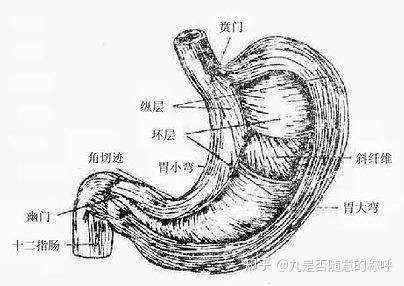
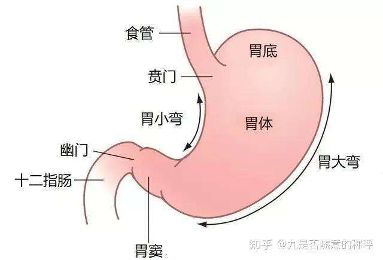
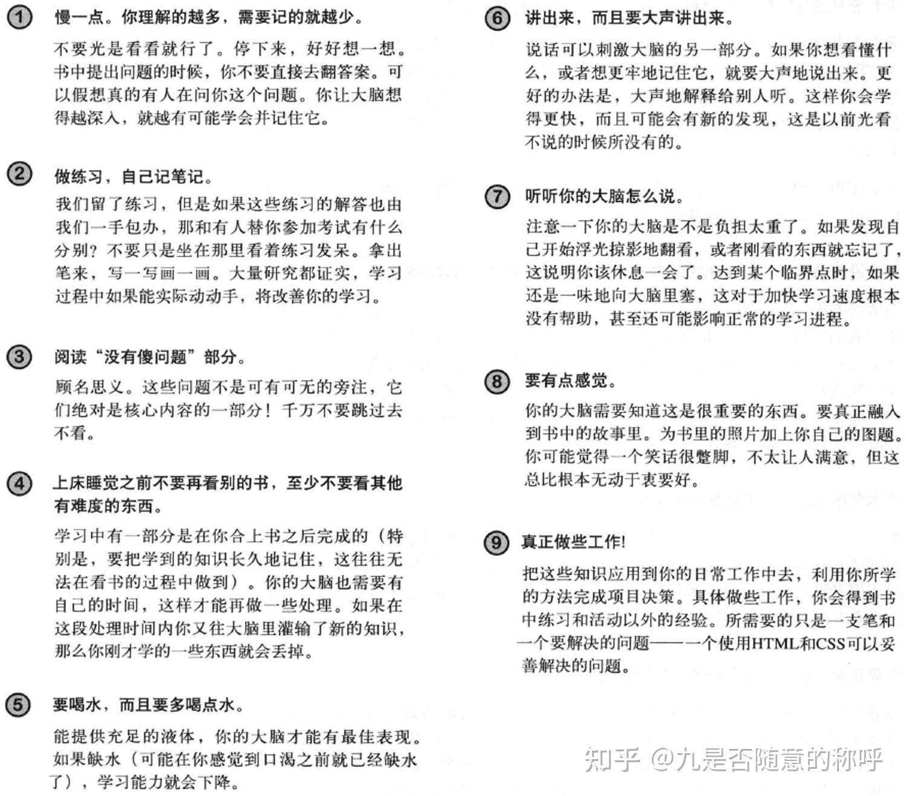
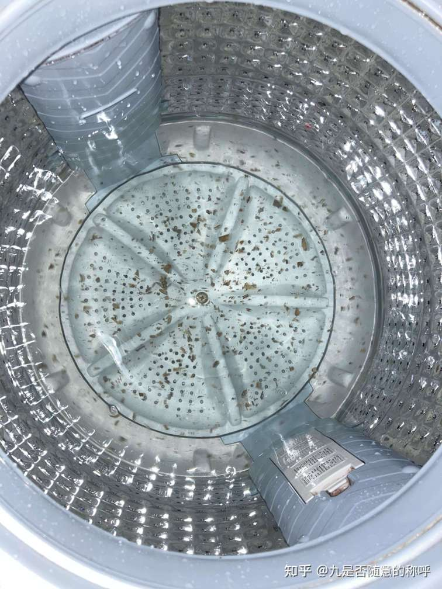
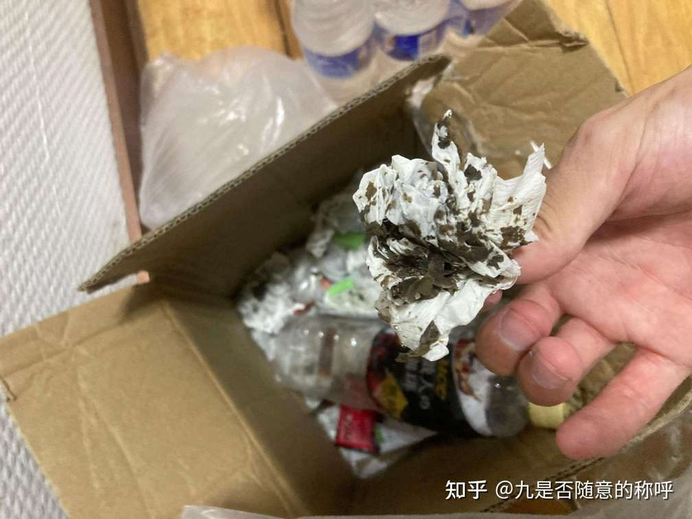

# 生活规范以及指导---future家规

### 

[农村和城市的生活方式](https://zhuanlan.zhihu.com/p/655237278)

[202310接下来的安排--持续修改的 - 知乎 (zhihu.com)](https://zhuanlan.zhihu.com/p/659296345)

想到吃肉的时候为什么不能吃饭了，因为根据饲料比：1斤饲料/动物涨了多少体重，吃饭就会拉便便，只吃肉不占肚子，所以能更好的消化吃下去的肉，不吃饭的话，消化肉的胃酸液更多，消化更彻底，肉在身体内停留的时间更多，消化时间更多。吃饭的话就会导致拉便便的时间变短，饭吃多了就会拉便便，肉在肚子内停留的时间短，消化的时间也短。

所以家人朋友聚餐的时候，吃很多肉的话，就不要吃饭了，吃饭会占据体积，导致肉食物在身体停留的时间变短。消化的时间变短，吸收的营养变少。

而且从另一个角度来看，一斤肉，鱼鸡鸭可能需要1.3-1.6斤饲料，猪可能需要2.6-3.9斤饲料，牛可能需要6-20斤饲料，也就是动物吃很多斤饭才能长一斤肉，所以吃饭是不划算的，肉这么珍贵，自然不用吃饭了，想吃饭随时都可以吃，但是动物的肉需要很多饭饲料才能长一点点，所以聚餐就不要吃饭了，这个时候肉和饭，显然肉更值钱，也更具有营养价值的，让肉消化更长的时间不是更好么。

若是聚餐的时候想吃饭，最好一开始就吃饭，最后再吃肉，而不是吃完肉再吃饭，这样吃的饭不会占据体积，拉便便的时候也是没消化完的饭先排出来。否则吃完肉再吃饭，先排出来的就是没消化完的肉了。

[上午清醒大脑，毕业时的钱数 - 知乎 (zhihu.com)](https://zhuanlan.zhihu.com/p/626488150)

一日之计在上午，睡了一晚上，大脑的代谢产物和废弃物都基本清理干净了，刚起床时候的大脑是最清醒，最干净的呢，这个时候还需要动力，也就是需要充足的能量，上午吃饱以后，给清醒的大脑提供充足的动力，晚上，大脑的代谢产物已经很多了，大脑比较疲惫，这个时候需要休息了，所以晚上要睡好，最好是early sleep，early wake up。

据此上午脑力活是最好的，晚上体力活最好，下午经过午休以后。上午吃饱可以给清醒的大脑提供充足的能量，充足的能量加上清醒的大脑能提升学习效率。下午之前要午休。

课间的困意，是大脑收集的数据过多，需要从临时保存的地方转存到其他地方。所以要有课间休息，课间休息最好睡觉，保存记忆的同时让大脑休息好。若是有困意但是不睡，临时保存的地方容量不够会删掉之前的记忆。所以及时保存及时短时睡眠。

[口水和对人生的思考 - 知乎 (zhihu.com)](https://zhuanlan.zhihu.com/p/652905285)

吃饱了，需要注意的就是饱暖思淫欲，吃饱了就要工作，做事情。而不是吃饱了就直接去玩耍，也不要饱暖思淫欲，吃饱就直接和女生做些不好的事情。感觉某些某部分美国人就是饱暖思淫欲，吃太多了纵欲过度，才会导致色情泛滥。

我现在已经可以做到，吃饱了就做事情，饱暖思淫欲我是相当警惕的，时时刻刻提醒自己，吃饱了要做事情。基本可以不会发生这样的事情。想都不敢去想的。

[2023-07相关的内容和想法 - 知乎 (zhihu.com)](https://zhuanlan.zhihu.com/p/641726833?)

眼保健操能保护眼睛的真正reason，我感觉是关闭了视觉输入传感器眼睛，大脑需要处理的信息变少了，也就是说大脑空出来可以休息，可以处理更多其他的事项，用phone类比的话就是，少开了几个APP不卡了，所以眼保健操能起作用，更多的是关闭了 [视觉传感器](https://zhida.zhihu.com/search?content_id=234589120&content_type=Article&match_order=1&q=%E8%A7%86%E8%A7%89%E4%BC%A0%E6%84%9F%E5%99%A8&zhida_source=entity)眼睛的输入，大脑能休息能处理其他事情，不信的话你可以闭上眼睛10min就行，看看能不能休息，闭上半只眼睛也可以。

眼保健操闭上眼睛-这个视觉传感器以后，大脑不需要处理图片，节省了很多的计算资源的，所以可以放松大脑，而且还需要遮光才行，光闭上眼睛作用有的但是不大，还需要用手指或者手掌挡住光线，黑暗的环境，大脑才会正式的放松和休息。安全的环境，像是自己家里、卧室，不是外面的空间，还可以尝试用耳塞堵住耳朵关闭 [听觉传感器](https://zhida.zhihu.com/search?content_id=234589120&content_type=Article&match_order=1&q=%E5%90%AC%E8%A7%89%E4%BC%A0%E6%84%9F%E5%99%A8&zhida_source=entity)，大脑在处理声音的时候，自我感觉需要的计算资源比图片少了很多，所以通常情况下，用手捂住眼睛就可以了。

进食breakfast、lunch以后的消化，人体的胃是倾斜的，不是水平的，而且出口在左侧上方，下面还向上弯曲了，进口在上方，所以咀嚼以后的食物从上到左上侧，要想充分的使用胃的酸液来消化食物，通过食物堵住左上侧的出口，以及胃出口自身的S型弯管，会自动存储很多酸液，然后慢慢等消化是可以的，这样消化的话，就是底部的食物最先消化，然后进入幽门和 [十二指肠](https://zhida.zhihu.com/search?content_id=234589120&content_type=Article&match_order=1&q=%E5%8D%81%E4%BA%8C%E6%8C%87%E8%82%A0&zhida_source=entity)，从底部开始消化食物的，慢慢的所有的食物就都消化完了，平躺起来的话，积聚的酸液更多，消化的时间需要的更少，因酸液变多了，单位时间消化的食物也变多了，躺着消化和站着消化，感觉没有任何区别，唯一的区别，就是站着消化慢一点，躺着消化快一点。感觉时间应该也差不了多少。这些年基本都是站着消化。

  

  

不要挑食的呢，人是各种各样的元素组成的，像碳、氢、氧、钙、铁、钾、锌、矿物质、 [纤维素](https://zhida.zhihu.com/search?content_id=234589120&content_type=Article&match_order=1&q=%E7%BA%A4%E7%BB%B4%E7%B4%A0&zhida_source=entity)、各种蛋白质、各种微量元素，各种 [氨基酸](https://zhida.zhihu.com/search?content_id=234589120&content_type=Article&match_order=1&q=%E6%B0%A8%E5%9F%BA%E9%85%B8&zhida_source=entity)，所以只吃几种单一的食物，很容易导致身体内某种元素不足，导致身体营养跟不上，也就是缺少某些营养物质少了，挑食是错误的，只吃蔬菜就会导致 [锌元素](https://zhida.zhihu.com/search?content_id=234589120&content_type=Article&match_order=1&q=%E9%94%8C%E5%85%83%E7%B4%A0&zhida_source=entity)不足，发育迟缓的呢，少吃肉，就会导致锌、钙以及各种营养物质缺乏，就像种植物那样，水稻需要施肥，白菜需要施肥，水稻需要钾肥、氮肥、 [磷肥](https://zhida.zhihu.com/search?content_id=234589120&content_type=Article&match_order=1&q=%E7%A3%B7%E8%82%A5&zhida_source=entity)等，以及农家肥，不施肥，植物基本长不大，热带地区虽然可以种植三季的水稻，但是只有第一季的水稻产量最高，后面两季的水稻产量会越来越低，就是因土壤内缺少了营养物质，所以一般都是轮换着种不同的作物，植物的生长是需要各种元素的，更何况人呢，所以人也是各种食物都需要吃的，光吃蔬菜是不行的，光吃肉也是不行的，光吃坚果也是不行的，光吃馒头也是不行的，除非不想要身体了，打算搞垮身体，那么长期吃一样食品是可以的，不过这样身体会扛不住的，很容易生病的。人体的某些元素是微量元素，不需要太多的，所以可以偶尔补充的，但是某些是大量需要的，像 [碳水化合物](https://zhida.zhihu.com/search?content_id=234589120&content_type=Article&match_order=1&q=%E7%A2%B3%E6%B0%B4%E5%8C%96%E5%90%88%E7%89%A9&zhida_source=entity)这个，需要给人体提供能量，有些很重要，像锌身体发育需要，像钙骨头发育需要的，所以不同的年龄阶段，需要的营养物质的分布和数量也是不相同的。所以挑食是错误的。

个人不支持反对文字狱，反对将各种物体、文字、动作和行为等等和人关系起来的举动。

要是能找到人类基因内的大脑预训练模型，通过编辑这个预训练模型，就可以实现永生，实现知识永固，不用重复背记知识了

看黄色是要给钱的，没钱所以不看，国外的黄色，国外的留学生姑娘还，所以是连累到这些留学生了么，难怪这些留学生姑娘对我不好

睡眠不足会提升性感，憋尿有性感就是睡眠不足，睡会就好了的

你们知道为啥体育锻炼，能提升人的性感么，因为体育和跑步、散步，走路，都会摩擦裆部，也就是内裤摩擦裆部，不停的走路，相当于是很轻的不断的摩擦裆部，所以性感就上升了，其实就相当于是年轻的男生或者女生，用手解决生理需求，重点就在不停的摩擦，体育锻炼像是走路、散步、跑步，都需要不停的摩擦裆部，所以性感上升很多，毕竟摩擦能产生快感。根据男性本人这些年的经验，用手可以在几十秒内到达更好的效果。

#########  消化、躺着和放松心脏

重力作用的话，食物会下降排出去，躺着食物可以在体内肠道停留更长的时间，延长消化时间的，而且躺着对心脏有好处，毕竟站着的话， [心脏泵血](https://zhida.zhihu.com/search?content_id=234589120&content_type=Article&match_order=1&q=%E5%BF%83%E8%84%8F%E6%B3%B5%E8%A1%80&zhida_source=entity)的高度差很大，心脏会更累，躺着的话心脏泵血会更轻松，所以躺着不仅可以延长消化时间，还能放松心脏的，延寿。

 **理发：** 

[工作回家知识--理发工具交叉感染--其它 - 知乎 (zhihu.com)](https://zhuanlan.zhihu.com/p/675738669)

通过自身的情况，我觉得理发店，应该对公共使用的物品，像剃发工具，进行消毒的，次氯酸可以灭掉几乎所有的细菌和真菌，以后有条件的话，我打算自己购买一套理发的工具，用来自己理发，或者去理发店的时候，让理发师用自己的理发工具，避免交叉感染。

我感觉目前绝大多数的理发店，对剃发工具都是不消毒的，交叉感染的可能性很大，送了一瓶 [次氯酸消毒片](https://zhida.zhihu.com/search?content_id=234589120&content_type=Article&match_order=1&q=%E6%AC%A1%E6%B0%AF%E9%85%B8%E6%B6%88%E6%AF%92%E7%89%87&zhida_source=entity)100片给之前的理发店，以及喷壶的。

 **次氯酸：** 

[202four-01接下来的安排--持续修改的 - 知乎 (zhihu.com)](https://zhuanlan.zhihu.com/p/675738161?)

[监督者--劳逸结合的--工作--亲情--休息 - 知乎 (zhihu.com)](https://zhuanlan.zhihu.com/p/676363140)

次氯酸消毒片很好用，之前戴头盔，脑袋很痒的，而且很多头屑的，洗头发也没用，很痒很多头屑的，即使剃了光头，即使涂了药，没头屑了不痒了，但只要一戴头盔，出汗，然后还是很痒很多头屑。

但头盔内喷了很多次氯酸消毒液以后，戴头盔出汗，脑袋不痒也没有任何头屑了，头盔内的细菌和真菌，都被灭掉了，所以次氯酸可以灭杀所有的细菌和真菌，确实是真的，名不虚传呢，现在戴头盔，一点都不痒，没有任何头屑了，不会反复感染了，不然之前涂了药，本来不痒没头屑了，只要戴头盔还是痒还是有头屑，用了次氯酸消毒液，才避免了反复感染的

我相信了次氯酸可以灭掉所有的细菌和真菌，以后次氯酸就是必备的消毒用具了，可以避免反复感染的。

### 睡眠

光线、声音、温度

### 决策

早上，吃饭，长时间，能量充足，大脑清醒

避免身体不好、脑子不清醒的时间，像：发烧、感冒、遗精以后的一周时间、泄精以后的一周时间

越重要的决策，脑子越清醒越好，拖得时间越长越好，像多少日的，时间越长收集的信息越多，大脑能综合参考的信息更多；

多收集相关的资料和信息；

[不是藓，被冷落和族人，延长消化时间 - 知乎 (zhihu.com)](https://zhuanlan.zhihu.com/p/682402878)

红颜不是祸水， [后宫佳丽三千](https://zhida.zhihu.com/search?content_id=234589120&content_type=Article&match_order=1&q=%E5%90%8E%E5%AE%AB%E4%BD%B3%E4%B8%BD%E4%B8%89%E5%8D%83&zhida_source=entity)才是问题的根源所在，是亡国之本，泄精以后脑子不清醒，做出的决策不对才是祸水，祸水是脑子不清醒。

## 延长消化的时间

过年期间吃了很多肉的，离开老家前一日，更是只吃肉不吃饭不吃主食，吃了这么多的肉，要好好消化才行，所以从老家出来以后，在城市的这几日基本只吃零食和水果，而且长时间躺在床上，不饿的话就用手机背背单词的，帮助消化的，减少排便次数，防止提前将吃下的肉排泄出来，要延长肉类消化的时间，也就是延长肉类在肠道内的停留时间。躺着能避免重力作用，站着或者坐着的话重力会导致食物不停下坠提前排泄。所以从老家出来以后只吃零食和水果，躺在床上的，目的就是要延长肉类在肠道的停留时间，延长消化的时间，更好的更多的吸收肉类的营养物质。地瓜是帮助便秘的，地瓜是用来清空肠道的，吃了地瓜正常不到12个小时就会排泄，所以过年期间不要吃地瓜，不要吃红薯片，而且纤维素含量高的蔬菜也要少吃，纤维素能增加肠道蠕动，提前排便的，所以过年期间若是吃肉比较多的话，最好少吃甚至别吃蔬菜和地瓜，别吃纤维素含量高的菜，否则会减少肉类的消化时间，吸收到的营养物质也很少，提前排便的话，营养物质吸收不完全，剩下的营养物质都在排泄出来的屎内的，老人常说吃屎吃屎，就是消化时间过短导致的，这个时候就要想办法延长消化时间，跑步或者散步、少吃然后多躺一段时间、别吃地瓜和纤维素含量高的蔬菜、坐高铁，都能延长消化的时间，这里面，尤其是别吃地瓜，吃了地瓜基本上12个小时左右就会排便的，最经济最安全的办法就是在床上多躺一段时间，别吃地瓜和蔬菜的。

[不同喂养方式肉食动物的营养价值，延长消化时间的方式 - 知乎 (zhihu.com)](https://zhuanlan.zhihu.com/p/682191871)

通常装黄豆的罐子，或者装其他物品的罐子，通过不停的摇动晃动，可以多装很多，也就是黄豆之间的空隙更小了，物品之间的空隙更小了。

然后，每一次坐高铁，明显感觉到排便的时间变长了，放屁的次数减少了，高铁不停的振动，将肠道内的食物弄的更加紧致，所以肠道内的食物空隙更小，肠道内食物之间的空气含量更少，肠道能装的食物更多，食物的消化时间也就延长了，排便的间隔时间也更长了的，放屁的次数也减少了。

跑步也是相同的道理，跑步可以让肠道内的食物变得更加紧致，可以减少肠道内食物之间的空气含量，可以延长消化时间，可以减少放屁的次数。

走路和跑步，哪个效果更好呢，目前来看跑步可能更好的。

坐火车前先排便排尿，在火车上就不用排便了，而且火车的震动，会显著延长消化的时间，减少排便的次数。

[Hi，WeChat没开会员的，所以我用这个的，…](https://www.zhihu.com/pin/1742612869143920640)

延长消化的方式叁：同样的罐子，用来装大米，或者装大米粉，那么肯定大米粉装的更多，大米有空隙空气，大米粉空隙很小，所以肠道要多装食物，就需要充分嚼碎食物，充分咀嚼的，充分咬碎以后的食物，还有个好处，就是消化液接触的表面积更大，消化起来更加容易的，就想吃棒棒糖，一根含着要很长时间，但要是将棒棒糖咬碎了，那么短时间内棒棒糖就都融化了，所以充分咬碎食物，不仅可以让肠道装更多的食物，还可以加速消化，缩短消化的时间，增加和消化液的接触表面积。

但有些人牙齿不好，像老人和小孩，这个时候就需要在吃之前，充分切碎食物，或者剁成泥，像肉泥，剁碎以后的食物，剁碎蒸熟以后，往往食物都黏成一团了，这个时候还需要剁碎，所以最好蒸熟弄熟以后再剁碎，这样就不需要咀嚼了，直接吞下就行，不过可能不太好吃，碎肉团子蒸熟以后还是整体的，还需要充分的咀嚼咬碎才行。

所以延长消化的整体流程是：充分剁碎食物，吃稀碎的食物，可以增加和消化液接触的表面积，加速消化的，还可以让肠道多装些食物，所以需要充分的咀嚼，咬碎食物的。

吃完食物以后，就可以通过散步、跑步来摇匀食物，减少肠道内食物之间的空隙和空气，减少放屁的次数，还可以让肠道多装食物的，重力会让食物往下面坠落，躺着能抵消重力作用，这样就可以延长食物在肠道的停留时间，延长消化的时间，延长吸收营养的时间。所以躺着可以延长食物在肠道的停留时间。

另外吃很多肉的话，最好别吃蔬菜和地瓜，别吃含纤维素多的食物，纤维素多的食物会增加肠道蠕动，加速排便的，吃地瓜更是会在12小时左右排便，所以过年过节吃了很多肉的话，最好别吃蔬菜和地瓜，尤其是地瓜，吃很多肉的话不要吃的。

消化具体的实例：米饭配汤就行，汤少许就行，不用太多的，让米饭变成一粒一粒的就行，这样米饭就是一粒一粒的，而不是一团一团的，减少了咀嚼的次数，而且不会粘在一起，消化液接触表面积更大，当然若是配汤一粒一粒的，还继续咀嚼的更碎，那当然更好了。

### 少吃多餐

少吃多餐，两个大馒头，三个大花卷，每隔三个小时吃一个，记录：10天不需要上厕所

少吃多餐可以充分消化，分泌的胃液数量足够消化少量餐食，一次吃太多胃液分泌不足不能完全消化

少吃多餐，可以减少犯困的时间，中午没那么困，虽然中午还是需要睡觉，少吃可以减少体液中葡萄糖的浓度，消化 [耗氧量](https://zhida.zhihu.com/search?content_id=234589120&content_type=Article&match_order=1&q=%E8%80%97%E6%B0%A7%E9%87%8F&zhida_source=entity)降低，大脑供氧量变多，没那么困倦的

### 日常

### 食品

### 大脑

### 记忆

大脑的记忆容量是有限的，后来的知识容易挤走前面的知识，读书的话学生睡前少看电视

上床睡觉之前不要再看别的书，至少不要看其他有难度的东西。

学习中有一部分是在你合上书之后完成的（特别是，要把学到的知识长久地记住，这往往无法在看书的过程中做到)。你的大脑也需要有自己的时间,这样才能再做一些处理。如果在这段处理时间内你又往大脑里灌输了新的知识,那么你刚才学的一些东西就会丢掉。

要喝水，而且要多喝点水。

能提供充足的液体，你的大脑才能有最佳表现。如果缺水（可能在你感觉到口渴之前就已经缺水了)，学习能力就会下降。

做练习，自己记笔记。

我们留了练习，但是如果这些练习的解答也由我们一手包办，那和有人替你参加考试有什么分别?不要只是坐在那里看着练习发呆。拿出笔来，写一写画一画。大量研究都证实，学习过程中如果能实际动动手，将改善你的学习。

来自书籍的《Head First HTML与CSS 第2版》

  

### 休息

### 睡眠

[睡眠腰椎和床垫的硬度](https://zhuanlan.zhihu.com/p/702402287)

睡眠腰椎和床垫的硬度 

[https://www.alipan.com/s/5SLh4XsGkxK](https://www.alipan.com/s/5SLh4XsGkxK) 点击链接保存，或者复制本段内容，打开「 [阿里云盘](https://zhida.zhihu.com/search?content_id=234589120&content_type=Article&match_order=1&q=%E9%98%BF%E9%87%8C%E4%BA%91%E7%9B%98&zhida_source=entity)」APP ，无需下载极速在线查看，视频原画倍速播放。

### 记忆力

### 皮肤病

[真菌无处不在、功能多样对人类的影响也各不相同，起着极其重要的作用-CSDN博客](https://zoujiu.blog.csdn.net/article/details/143081673)

头皮发痒尽量不要使用手指去挠，头皮相当是培养基，手指是接种感染源头的，手本来很脏的，手要接触各种各样的脏物品，桌面、鞋子、袜子、衣服、皮肤、毛巾、洗碗、洗菜，所以手是很脏的。头皮发痒用手去挠，手指上面的各种各样的菌落或者真菌就会接种到头皮上，头皮上的营养刚好可以做培养基。

所以头皮发痒不要用手指去挠，用梳子去挠是最好的，就算要用手指挠，也要先用肥皂洗干净手才行。最好用干燥干净的布料来包裹然后摩擦止痒，或者使用梳子来止痒。

同样，尽量不要用手去挠面部，其他身体部分的，很容易感染的，手还是很脏的。

所以，头皮屑很多的人，在y使用药物彻底灭掉头皮上的真菌和菌落以后，就需要使用梳子来止痒，改掉用手指挠头皮的坏习惯。空气，阻止空气中的病菌进入头皮，女性使用梳子的原因，也是可以替代手指来止痒，阻止了手指接触头皮。女性头皮痒以后隔着厚厚的密集的头发挠，也能阻止手指直接接触头皮，避免了病菌直接接触到头皮。

所以，头皮屑很多的人，在使用药物彻底灭掉头皮上的真菌和菌落以后，就需要使用梳子来止痒，改掉用手指挠头皮的坏习惯。 **所以男性也是需要梳子的。男性需要梳子的原因，主要还是挠头皮，次要的就是整理发型。** 

总之，用手指挠头皮，是一个坏习惯，没有用肥皂清洗干净的手指挠头皮，更是直接接种病菌到头皮上，要不得。

脸上发痒可以尽量忍着，或者用衣物来包裹好手掌然后挠的，最次的就是用手背摩擦，不推荐手指挠，手指挠也相当是接种病菌到脸上。

### 头皮屑

自从去年剃光头以后，现在又有很多头皮屑了，可能是头皮 [真菌感染](https://zhida.zhihu.com/search?content_id=234589120&content_type=Article&match_order=1&q=%E7%9C%9F%E8%8F%8C%E6%84%9F%E6%9F%93&zhida_source=entity)了，可能是剪头发的时候交叉感染的，也可能是手指太脏了，偶尔手指触到 [头皮感染](https://zhida.zhihu.com/search?content_id=234589120&content_type=Article&match_order=1&q=%E5%A4%B4%E7%9A%AE%E6%84%9F%E6%9F%93&zhida_source=entity)的，也可能是献血以后皮肤层的血液量减少导致的，也可能是免疫力下降导致的。

总之，又有很多头皮屑了，得来点 [盐酸特比萘芬片](https://zhida.zhihu.com/search?content_id=234589120&content_type=Article&match_order=1&q=%E7%9B%90%E9%85%B8%E7%89%B9%E6%AF%94%E8%90%98%E8%8A%AC%E7%89%87&zhida_source=entity)了

我想明白为什么用12片（兑6升水）次氯酸消毒洗衣机的时候有这么多污垢出现了，主要还是次氯酸消毒能力太好了，之前洗衣机上附着了很多细菌和真菌，它们分泌了很多粘液，即使是平时用洗衣机洗衣服，脱水都不能弄掉这些附着的 [微生物](https://zhida.zhihu.com/search?content_id=234589120&content_type=Article&match_order=1&q=%E5%BE%AE%E7%94%9F%E7%89%A9&zhida_source=entity)，次氯酸基本能灭掉所有的微生物，所以细菌和真菌失活以后，不能继续附着在洗衣机上，就出现了很多污垢的，说明了次氯酸片是正品有效果，次氯酸消毒能力真好，平常的家用消毒液根本达不到这个效果，说明家用消毒液消毒能力没有次氯酸好。男生还是需要梳子的，梳子还是有必要。

  

  

[次氯酸能杀死真菌么? - 化工博士的回答 - 知乎 https://www.zhihu.com/question/383139730/answer/2038105295](https://www.zhihu.com/question/383139730/answer/2038105295)

### 学习

 

[https://zhuanlan.zhihu.com/p/659072692](https://zhuanlan.zhihu.com/p/659072692) 

